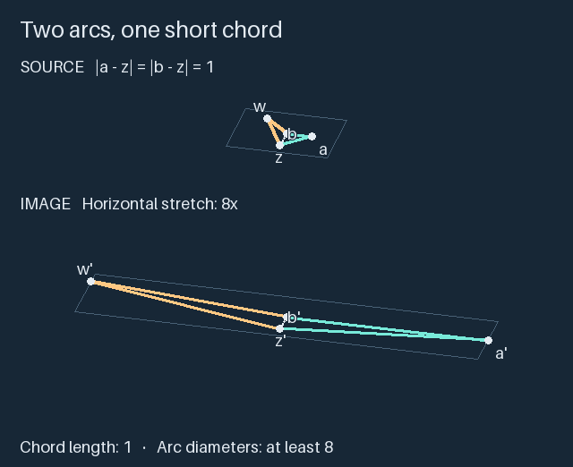

# Qualitative quasicircle preservation implies quasiconformality

 ·  · 

Every homeomorphism of a closed oriented Riemann surface that sends quasicircles to quasicircles is quasiconformal. On a surface of positive genus, the essential quasicircles suffice. For the essential quasicircle graph in genus at least two, its full automorphism group is therefore the quasiconformal group.

[Complete manuscript](paper/manuscript.pdf) · [Proof in Markdown](proof/PROBLEM_AND_PROOF.md) · [Offline illustrated guide](https://raw.githubusercontent.com/DannyExperiments/qualitative-quasicircle-preservation/v1.0.0/visualization/construction-explorer.zip) · [Reproduction instructions](REPRODUCIBILITY.md)

## Proof idea

For a non-quasiconformal homeomorphism, choose small, well-separated disks with distortion ratios tending to infinity. Uniformly bilipschitz patches put all the marked triples on one quasicircle. Each distorted triple forces the image arc through its middle point to have large diameter relative to the distance between its endpoints. A fixed point on the complementary arc supplies its diameter lower bound. The image circle fails bounded turning.

## Prior work

Ahlfors supplies bounded turning and Väisälä gives the metric characterization of quasiconformal maps. Gehring's round-circle criterion and Aseev's quantitative criteria assume a common image bound. Booth, Nolte and Verberne use a coarse order condition to bound the images of different essential quasicircles. Their introduction asks the qualitative preservation question addressed here. [Literature audit](audits/public_safe_reports/LITERATURE_AUDIT.md)

## Worked example

Take the polygon in cyclic order z = (0,0), a = (1,0), b = (0,1), w = (−1,−1). Stretch the horizontal coordinate by 8. The distance between the images of z and b is still 1, while the two arcs have diameter at least 8 and √65, respectively. The same stretch can be applied with every factor on the explorer slider. The manuscript's sequence of patches makes the lower bound diverge on one image curve.

## Verification and status

The finite exact-arithmetic replay checks the worked example and a model plateau and support-disk construction. The full proof supplies the infinite and topological arguments. The independent internal mathematical review checked the theorem and graph corollary. The manuscript has not been peer reviewed. See the [mathematical audit](audits/public_safe_reports/MATHEMATICAL_AUDIT.md), [status](STATUS.md), [scope](CLAIM_SCOPE_AND_LIMITATIONS.md), and [AI disclosure](AI_DISCLOSURE.md).
